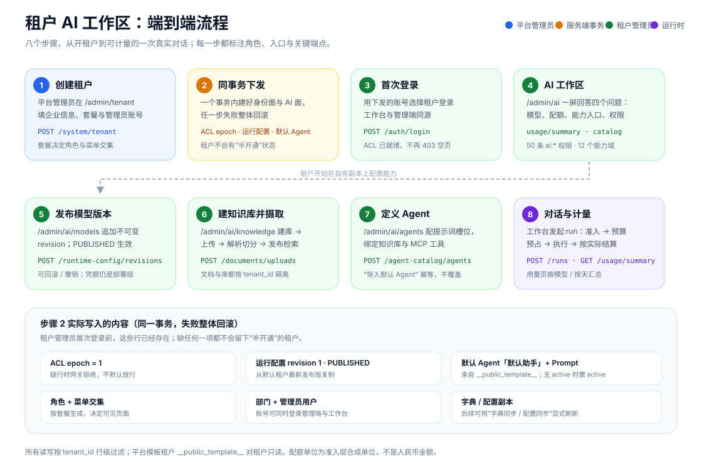

# 租户 AI 工作区：流程、权限与部署

本文说明一个租户从“被创建”到“跑出第一次可计量的对话”之间发生了什么，以及如何把这条链路部署起来。
文中所有端点、字段与开关都取自当前源码；未实现的部分在最后一节单独列出，不当作已完成。



## 1. 角色与入口

| 角色 | 登录入口 | 能做什么 | 不能做什么 |
| --- | --- | --- | --- |
| 平台管理员 | `/admin/`（租户 `000000` 或任一平台租户） | 开通/停用租户、配套餐、看全平台租户 AI 总览、维护平台模板 | 不能直接把内容写进某个租户的目录；AI 资源按登录租户解析 |
| 租户管理员 | `/admin/`（登录时选择自己的租户） | 管理本租户的模型版本、知识库、Agent、Skills、MCP、查看本租户用量与配额 | 不能读写其他租户的数据；不能改平台模板 |
| 普通成员 | `/`（工作台） | 对话、检索、使用已授权的 Agent | 不能进入管理端菜单（除非另有角色） |

“AI 权限在哪里管理”的答案只有一处：**角色管理 → 分配菜单**，再由**租户套餐**放行。没有第二套 AI 权限表。

## 2. 端到端流程

### 步骤 1：平台管理员创建租户

- 入口：管理端 `/admin/tenant` → 新增租户。
- 调用：`POST /system/tenant`（`system:tenant:add`，服务端同时要求超管角色）。
- 必填：企业名称、联系人、联系电话、套餐、管理员账号与初始口令。
- 服务端行为：按套餐生成角色与菜单交集，创建部门与管理员用户。
- 确认方式：列表出现新租户；创建成功的弹窗会给出租户编号与管理员账号（不回显口令）。

### 步骤 2：同一事务内下发 AI 工作区

这一步没有单独按钮，和步骤 1 在同一个数据库事务里完成，失败整体回滚：

| 写入内容 | 作用 | 缺省时的后果 |
| --- | --- | --- |
| `ai_acl_epoch` 一行（version=1） | AI 身份的租户版本事实 | 网关拒绝，不默认放行 |
| `ai_runtime_config_revision` revision 1 · PUBLISHED | 租户的默认模型与参数 | 工作台没有可用模型 |
| `ai_agent_profile`「默认助手」+ `ai_agent_prompt` 槽位 | 开箱可用的 Agent | 工作台无 Agent 可选 |
| 角色、菜单、部门、管理员用户 | 身份面 | 无法登录或看不到菜单 |
| 字典与配置副本 | 租户独立配置 | 可在租户页用“字典同步/配置同步”补 |

默认助手来自平台模板租户 `__public_template__`。模板缺失时该段插入 0 行，不影响租户创建；之后可以用
`POST /api/ai/v1/agent-catalog/agents/import-default` 手动补，幂等且不覆盖租户已有改动。

### 步骤 3：租户管理员首次登录

- 入口：`/admin/` 或 `/`，登录时选择租户。
- 调用：`POST /auth/login`。
- 服务端行为：解析租户上下文；ACL 与运行配置已在步骤 2 就绪，因此不会出现“登录后整页 403”或空列表。
- 确认方式：进入 `/admin/ai` 能看到模型、配额与能力计数。

### 步骤 4：在 AI 工作区确认现状

- 入口：`/admin/ai`。
- 读取：
  - `GET /api/ai/v1/runtime-config/catalog`（当前发布版本）；
  - `GET /api/ai/v1/usage/summary?days=1`（调用、token、配额）；
  - `GET /api/ai/v1/agent-catalog/agents`、`/knowledge-bases`、Skills、MCP 计数。
- 输出：模型与 revision、配额剩余/已结算/在途、24h 调用、能力入口与 AI 权限域。

### 步骤 5：发布模型版本（可选）

- 入口：`/admin/ai/models`。
- 调用：`POST /api/ai/v1/runtime-config/revisions`（`config.publish`），或对既有版本 `.../revisions/{id}/rollback`。
- 规则：revision 不可变；发布后成为运行权威；可撤销（`revoke`）或回滚到旧版本。
- 边界：**provider 凭据仍是部署级**（`credential_ref=env:...`），租户目前不能自带 key。

### 步骤 6：建知识库并摄取文档

- 入口：`/admin/ai/knowledge`。
- 流程：
  1. `POST /api/ai/v1/knowledge-bases`（`kb.write`）建库；
  2. `POST /api/ai/v1/documents/uploads`（`document.upload`）上传；
  3. `POST /api/ai/v1/documents/{id}/ingestions`（`document.ingest`）触发解析与切分；
  4. 在文档/分块页确认发布状态，必要时手动调整分块。
- 边界：文档、分块、向量都带 `tenant_id`；检索授权集合为空时不会扩大为全库查询。

### 步骤 7：定义 Agent 并绑定能力

- 入口：`/admin/ai/agents`。
- 调用：
  - `POST /api/ai/v1/agent-catalog/agents` 新建，`PUT .../{id}` 修改；
  - `PUT .../{id}/prompts/{slotKey}` 写提示词槽位；
  - `POST .../{id}/activate` 设为当前生效 Agent。
- 可绑定的能力：知识库、MCP 工具、Skills（目录行同样是租户副本）。
- 快捷方式：“导入默认 Agent”从模板复制一份，已有同名时不重复插入。

### 步骤 8：对话、计量与回收

- 入口：工作台 `/`（或 Agent 页面发起的运行）。
- 运行链：`POST /api/ai/v1/runs` → 准入校验（身份、ACL、许可）→ 预算预占 → 执行 → 按实际用量结算。
- 配额状态变化：
  - 运行开始：写入 `RESERVED`（在途）；
  - 成功结束：转为 `SETTLED`，`units` 按实际用量修正；
  - 失败/取消：转为 `RELEASED`，不计消耗。
- 观测：
  - `/admin/ai/usage`：24h/7d 会话、消息、成功率、配额、按模型/按天调用与 token、最近运行；
  - `/admin/ai/tenants`：平台视角，各租户 ACL、发布版本、默认助手、目录数量与 7 天用量。

## 3. 权限如何判定


一次 AI 请求要依次通过五层，任何一层缺失都拒绝：

1. `sys_menu.perms`：功能权限串（`ai:*`）是否存在；
2. `sys_role_menu`：角色是否被授予该菜单；
3. `sys_tenant_package.menu_ids`：租户套餐是否放行（实际生效 = 角色 ∩ 套餐）；
4. AI 网关 scope：委托令牌是否带具体动作（如 `agent.write`）；
5. 资源 ACL + 执行许可：主体/租户归属、共享 ACL、ACL epoch、撤销屏障。

补充规则：

- **平台目录第二道门**：`agent.* / skill.* / mcp.*` 默认还要求平台目录身份；开启
  `ai.integration.tenant-catalog-self-service=true` 后，租户管理员凭 `ai:*` 可管理**本租户副本**，
  平台模板仍只读。该开关默认 `false`。
- **超管通配不展开**：平台超管持有 `*:*:*`，但 AI 资源面按角色菜单实际绑定判定。
- **前端只做显示**：菜单隐藏、按钮禁用都不是授权；每个端点在后端独立判定。

## 4. 用量与配额口径

| 指标 | 来源 | 口径 |
| --- | --- | --- |
| 调用次数 / token | `ai_model_call`（带 `tenant_id`） | 按租户、按模型、按天聚合；usage 缺失计 0，不伪造 |
| 运行配额 | `ai_tenant_budget` + `ai_budget_reservation` | 上限、`SETTLED`、`RESERVED`、剩余、占用比 |
| 默认上限 | `p2.budget.default-tenant-units` | 租户没有预算行时回落，响应标记 `configured=false` |
| 花费信封 | `/api/ai/v1/runtime-config/spend` | **部署级**人民币信封，不按租户拆分，不与配额换算 |

配额是准入层真实执行的**合成单位**：它回答“这个租户还能不能继续跑”，不是账单。
按租户的人民币成本账本尚未实现（`ai_provider_spend` 无 `tenant_id`）。

## 5. 部署

### 5.1 方式 A：容器镜像（推荐）

发布链在 main 验证通过后产出两个不可变镜像：

| 镜像 | 内容 | 关键配置 |
| --- | --- | --- |
| `ruoyi-ai-agentscope-platform` | 唯一后端（`ruoyi-admin`） | `SPRING_PROFILES_ACTIVE=prod,embedded` |
| `ruoyi-ai-agentscope-web` | 工作台 `/` + 管理端 `/admin/` | 同源代理 `/api`、`/auth`、`/system`、`/resource`、`/monitor` 到 `platform:6039` |

```bash
# 用 release manifest 里的 digest 固定版本，不要用可变标签
docker pull ghcr.io/wonderchn/ruoyi-ai-agentscope-platform@sha256:<digest>
docker pull ghcr.io/wonderchn/ruoyi-ai-agentscope-web@sha256:<digest>

docker run -d --name platform --network app \
  --env-file /etc/ruoyi-ai/platform.env \
  -v /srv/ruoyi-ai/private-objects:/data/private-objects \
  ghcr.io/wonderchn/ruoyi-ai-agentscope-platform@sha256:<digest>

docker run -d --name web --network app -p 8080:80 \
  ghcr.io/wonderchn/ruoyi-ai-agentscope-web@sha256:<digest>
```

`platform.env` 至少包含：

```dotenv
SPRING_PROFILES_ACTIVE=prod,embedded
PLATFORM_DB_HOST=<postgres-host>
PLATFORM_DB_PORT=5432
PLATFORM_DB_NAME=ruoyi_agent
PLATFORM_DB_SCHEMA=platform,extensions
PLATFORM_DB_USERNAME=<app-role>
PLATFORM_DB_PASSWORD=<db-password>      # 必填，无默认值
REDIS_HOST=<redis-host>
REDIS_PORT=6379
REDIS_PASSWORD=<redis-password>        # 必填，无默认值
DEEPSEEK_API_KEY=<provider-key>        # 按实际提供方选填；缺失时该模型不可调用
DASHSCOPE_API_KEY=<provider-key>
```

完整镜像验证、manifest 与晋升规则见 [image-release.md](runbooks/image-release.md)。

### 5.2 方式 B：源码构建

```bash
# 后端
cd services/platform
mvn -B -ntp -Pdev clean verify
SPRING_PROFILES_ACTIVE=prod,embedded \
  java -jar ruoyi-admin/target/ruoyi-admin.jar --server.port=6039

# 前端（管理端必须带子路径）
cd ../web
pnpm install --frozen-lockfile
pnpm build
WEB_ADMIN_BASE_PATH=/admin/ pnpm --filter @ruoyi/admin build

# 静态托管：/ -> workbench dist，/admin/ -> admin dist
# 反向代理：/api/ /auth/ /system/ /resource/ /monitor/ -> 127.0.0.1:6039
# SSE（/api/ai/v1/.../events）必须关闭缓冲，上传上限与产品限制一致
```

`infra/dev/nginx.conf` 是一份可直接参考的同源配置：只代理白名单前缀、SSE 不缓冲、`/internal/` 与
`/actuator` 返回 404。

### 5.3 方式 C：本地开发栈

```bash
cat > infra/dev/.env <<'EOF'
DEV_PG_PASSWORD=<local-password>
DEV_REDIS_PASSWORD=<local-password>
DEV_SERVICE_CREDENTIAL=<local-credential>
DEV_CLIENT_ID=dev-client
DEV_WEB_PORT=8080
EOF

docker compose --env-file infra/dev/.env -f infra/dev/compose.yaml up -d --build
```

启动顺序由 compose 保证：`postgres` → `db-bootstrap`（角色/schema/扩展）→ `db-migrate`（Flyway 平台链 +
冻结 AI 链）→ `platform` → `web`。开发栈以内嵌形态运行，只有一个后端服务。

### 5.4 数据库与迁移

- 统一链位于 `services/platform/docs/script/sql/postgres`；冻结的旧链在
  `services/platform/docs/script/sql/legacy-ai`，只用于旧库升级验证。
- 版本号不连续，**不要自行补号、不要改既有迁移、不要另起一条链**。
- 迁移只向前：应用回退时数据库不会自动回退，回退版本必须兼容已应用的 schema。

### 5.5 健康检查与回退

```bash
# 平台就绪（actuator 受鉴权保护，用公开端点做探针）
curl -fsS http://127.0.0.1:6039/auth/tenant/list >/dev/null && echo platform-ok
curl -fsS http://127.0.0.1:8080/admin/ >/dev/null && echo web-ok
```

回退流程：

1. 保留上一版 JAR（或镜像 digest）与前端静态目录；
2. 恢复后重启进程/容器，确认上述两个探针恢复 200；
3. 不要为了回退重跑或改写迁移历史；
4. 私有对象目录与数据库不随应用回退出清理。

## 6. 验收清单

```bash
# 1) 平台管理员登录后创建租户，确认返回 200 且列表可查
# 2) 新租户管理员登录，确认 /admin/ai 可打开且显示模型与配额
# 3) 确认下发结果（数据库只读核对）
#    ai_acl_epoch=1、ai_runtime_config_revision revision=1 PUBLISHED、
#    ai_agent_profile 一行「默认助手」、ai_agent_prompt 若干槽位
# 4) 导入默认 Agent 幂等
curl -X POST -H "Authorization: Bearer <token>" \
  https://<host>/api/ai/v1/agent-catalog/agents/import-default
#    第一次 created=true，第二次 created=false
# 5) 用量与配额
curl -H "Authorization: Bearer <token>" \
  "https://<host>/api/ai/v1/usage/summary?days=7"
#    budget.limitUnits / settledUnits / heldUnits / remainingUnits 与
#    ai_tenant_budget、ai_budget_reservation 的 SQL 结果一致
# 6) 平台总览（超管 + system:tenant:list）
curl -H "Authorization: Bearer <token>" https://<host>/system/tenant/ai-overview
```

## 7. 当前不支持

- 租户级 provider 密钥（凭据仍是部署级 `env:` 引用）。
- 按租户的人民币成本账本与预算告警。
- 配额上限的在线修改（目前由运维写入 `ai_tenant_budget`）。
- Skills / MCP 的平台模板源（`__public_template__` 只有默认 Agent）。
- 平台管理员“进入租户上下文”管理 AI。
- 生产目标环境的完整验收；当前证据来自授权测试环境的合成数据。
