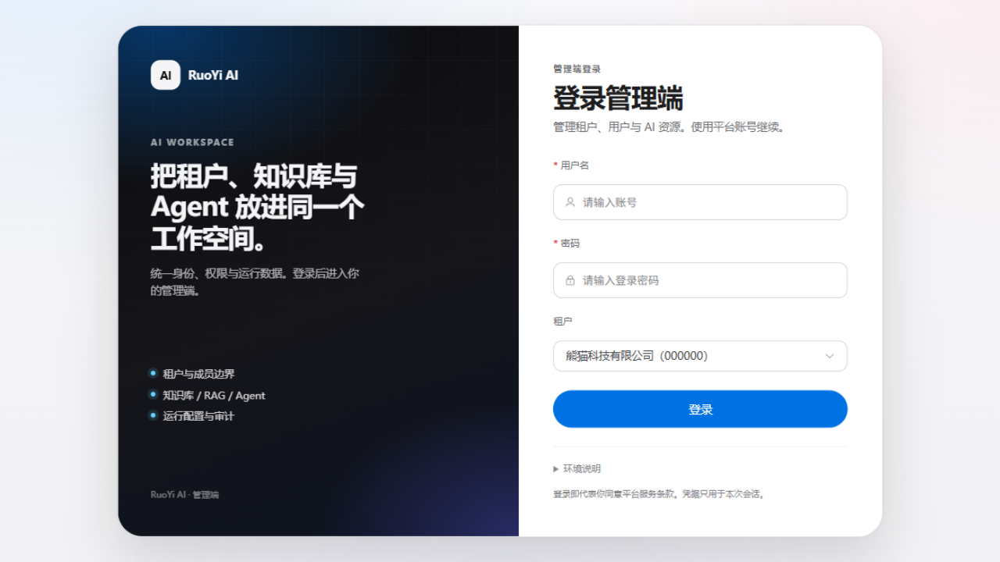
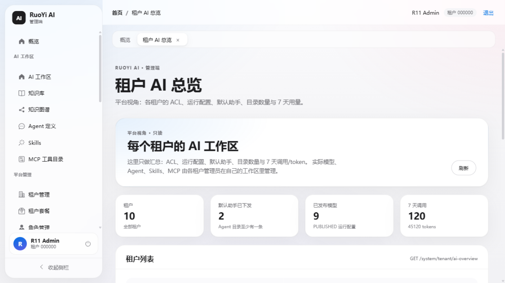
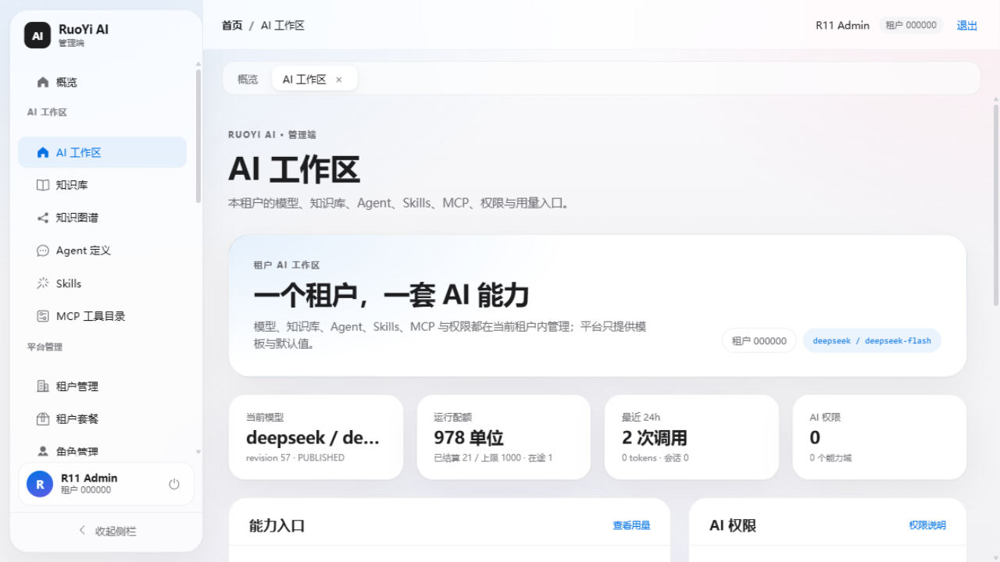
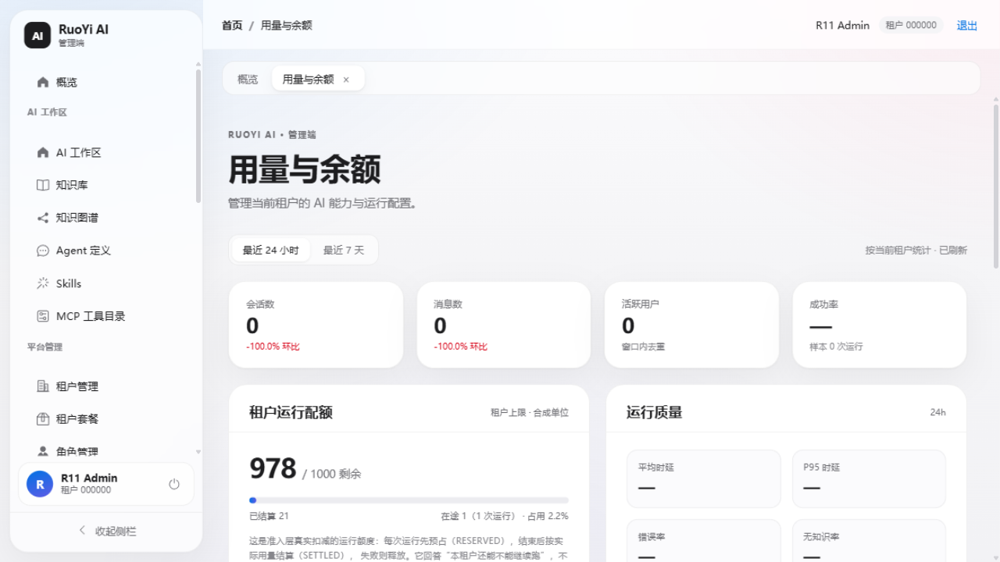
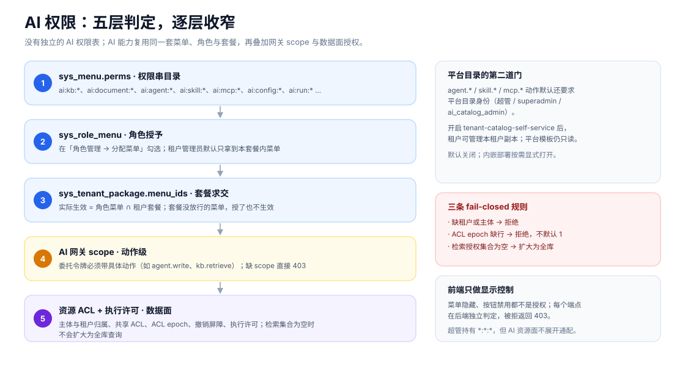

# 使用说明：每个功能怎么做

这是一份操作手册，不是架构文档。每个功能都按 **入口 → 怎么做 → 怎么确认成功 → 失败怎么办** 写。
先按你的角色找对应章节。

- 平台管理员：开租户、配套餐、看全平台、分配权限 → [第 1 章](#1-平台管理员)
- 租户管理员：模型、Agent、Skills、MCP、用量与配额 → [第 2 章](#2-租户管理员ai-工作区)
- 普通用户：聊天、知识库问答、Agent 任务 → [第 3 章](#3-普通用户工作台)
- 装环境：→ [部署说明](deployment.md)

## 0. 开始之前

### 0.1 两个入口

| 入口 | 地址 | 用途 |
| --- | --- | --- |
| 工作台 | `http://<host>/` | 聊天、知识库问答、Agent 任务，给普通用户 |
| 管理端 | `http://<host>/admin/` | 租户、用户、角色、菜单、AI 管理，给管理员 |

### 0.2 登录

1. 打开 `/admin/`。
2. 输入用户名与密码。
3. 在“租户”下拉里选择登录到哪个租户——**这一项决定你能看到哪套数据**，选错就是另一个租户的工作区。
4. 点“登录”。

同一个账号可以登录工作台；工作台和管理端共用身份，不需要重复注册。

### 0.3 权限不够时会看到什么

| 现象 | 含义 | 怎么办 |
| --- | --- | --- |
| 左侧菜单少一项 | 当前角色没被授予该菜单 | 用管理员账号去「角色管理 → 分配菜单」勾上，并确认租户套餐放行 |
| 页面显示“没有 xxx 权限，数据区不加载” | 页面主动不请求 | 同上；这是前端提示，后端也会独立拒绝 |
| 整页跳到 403 | 后端拒绝或网关 scope 不足 | 先查角色菜单，再查套餐；仍 403 说明该动作还要求平台目录身份（见 2.7） |
| 列表 0 条但页面正常 | 可能是筛选条件、也可能是权限晚到 | 先点“重置/刷新”；仍为空看 2.7 |

**授权只有一处**：角色管理 → 分配菜单，再由租户套餐放行。没有单独的“AI 权限表”。

## 1. 平台管理员

平台管理员默认是租户 `000000` 的超管账号；页面能力由角色菜单决定，下面按功能写。

### 1.1 开通一个租户

1. 进入 **租户管理**。
2. 点 **新增租户**。
3. 填写：

| 字段 | 说明 | 必填 |
| --- | --- | --- |
| 企业名称 | 租户显示名 | 是 |
| 套餐 | 决定该租户能拿到哪些菜单 | 是 |
| 管理员账号 | 该租户管理员的登录名 | 是 |
| 初始密码 | 首次登录用；创建后请让本人修改 | 是 |
| 联系人 / 联系电话 | 服务端要求 | 是 |
| 账号额度 / 过期时间 | 可选 | 否 |
| 状态 | 正常 / 停用 | 否 |
| 备注 | 可选 | 否 |

4. 点 **保存**。

**成功标志**：弹出“租户创建成功”，显示租户编号与管理员账号（不回显口令）；列表出现新租户。

**背后发生的事**（不需要你逐项操作）：同一事务内创建角色与菜单交集、部门、管理员用户、字典/配置副本、AI ACL 版本行、默认运行配置（revision 1 · PUBLISHED）、默认助手及其 Prompt。任一步失败整体回滚，不会留下“半开通”租户。

**失败怎么办**：

- 红字提示“企业名称/联系人/联系电话/管理员账号/初始密码不能为空”→ 补齐必填。
- “套餐下拉加载失败”→ 该账号没有套餐列表权限，或后端异常；换账号或联系平台管理员。
- 保存成功但列表没有 → 点“刷新”；仍无说明筛选条件没清空。

### 1.2 停用、启用、删除租户

1. 在租户列表找到目标行。
2. 点 **更多**：
   - **停用租户 / 启用租户**：立即生效，停用后该租户无法正常使用。
   - **删除租户**：不可恢复，先确认数据已备份。

**成功标志**：状态列变化；停用的行状态显示“停用”。

### 1.3 套餐同步、字典同步、配置同步

这三个动作不会自动发生，只在需要时手动点：

| 动作 | 什么时候用 | 结果 |
| --- | --- | --- |
| 套餐同步 | 改了套餐或套餐的菜单后，要让既有租户跟着变 | 按套餐重算该租户的角色-菜单 |
| 字典同步 | 默认租户 `000000` 改了字典，要下发给该租户 | 覆盖该租户字典副本 |
| 配置同步 | 同上，针对参数配置 | 覆盖该租户配置副本 |

入口：租户行 → **更多** → 对应项。**成功标志**：右上角出现“已按套餐 … 同步”“已同步 … 字典/参数配置”的提示。

> 套餐编辑不会自动回同步既有租户，这是设计上的显式动作。

### 1.4 查看全平台租户 AI 状态

入口：**租户 AI 总览**（`/admin/ai/tenants`），平台视角、只读。

1. 打开页面，默认加载全部租户。
2. 点 **刷新** 取最新数据。
3. 看四张统计卡：租户数、已下发默认助手的租户数、已发布模型数、7 天调用与 token。
4. 在表格里按租户查看：ACL 版本、最新 PUBLISHED 运行配置、Agent/Skills/MCP/知识库数量、7 天调用与 token、默认助手。

**用途**：判断哪个租户还没配好、哪个租户在跑量。平台管理员在这里看不到租户的具体对话内容，这是有意的。

### 1.5 给角色分配 AI 权限

这是“AI 权限在哪里管理”的唯一答案。

1. 进入 **角色管理**。
2. 找到要授权的角色，点 **分配菜单**。
3. 在弹出树里展开 **AI 工作区** 与 **AI 治理**，勾选需要的菜单，例如：
   - 知识库 → `ai:kb:*`、文档 → `ai:document:*`
   - Agent 定义 → `ai:agent:*`
   - Skills → `ai:skill:*`，MCP → `ai:mcp:*`
   - 模型与提供方 / 系统设置 → `ai:config:*`
   - 用量与余额 → `ai:run:read`
4. 点 **保存**。

**成功标志**：提示“菜单权限已保存”；让该角色的人重新登录后菜单出现。

**注意**：

- 超级管理员角色是只读展示，不能改。
- 角色勾了还不够：**租户套餐**也必须包含这些菜单，否则实际不生效。
- 平台级目录（Agent/Skills/MCP）在默认装配下还要求平台目录身份；要让租户管理员自己管，需要部署时开启 `ai.integration.tenant-catalog-self-service=true`（见 2.7）。

### 1.6 新建用户、重置口令、分配角色

1. **用户管理** → **新增用户**。
2. 填：账号、昵称、部门、口令（初始）、手机号、邮箱、状态。
3. 保存后回到列表。
4. 行 → **更多**：
   - **分配角色**：勾选角色后保存，决定这个人能看到哪些菜单。
   - **重置口令**：输入两次新口令，提交；提交后输入框自动清空，口令不落日志。
   - **停用账号 / 删除用户**：按需。

**成功标志**：列表出现新用户；该用户能登录并看到对应菜单。

## 2. 租户管理员（AI 工作区）

### 2.1 先看懂 AI 工作区

入口：**AI 工作区**（`/admin/ai`）。

四张卡分别是：

| 卡片 | 读法 |
| --- | --- |
| 当前模型 | 现在生效的 provider / model 与 revision 号；“PUBLISHED”才在跑 |
| 运行配额 | 剩余单位 / 上限；下方是已结算、在途。配额不是钱，回答“还能不能继续跑” |
| 最近 24h | 调用次数与 token；会话数来自运行统计 |
| AI 权限 | 当前账号拿到的 `ai:*` 条目数和能力域数量 |

下面两块：**能力入口**（知识库、Agent、Skills、MCP、摄取流水线、知识图谱，带真实计数）和
**AI 权限**（按域列出，可直接去角色管理）。最底部是快捷动作：发布模型、管理知识库、导入默认 Agent、查看用量。

### 2.2 发布、回滚、撤销模型版本

入口：**模型与提供方**（`/admin/ai/models`）。

**发布新版本**

1. 在“发布新版本”区域填写：
   - `providerId`：提供方标识；
   - `modelId`：从下拉里选已批准模型；
   - `catalogVersion`：模型目录版本；
   - `credentialRef（引用）`：写引用名，例如 `env:DEEPSEEK_API_KEY`——**这里永远不填明文密钥**；
   - 参数：temperature、topP、maxTokens 等，按需。
2. 点 **发布新版本**。

**成功标志**：提示“已发布服务端版本 revisionNo=…”；版本列表多一条 PUBLISHED。

**回滚**：在版本行点 **回滚（追加新版本）**。注意它是“以旧版本为模板再发一版”，版本号会变大，历史不会被改写。

**撤销**：在版本行点 **撤销**。PUBLISHED → REVOKED，**不可逆**；撤销后运行会按新的权威版本走。

**失败怎么办**：

- 页面显示“尚未发布运行配置权威 / 提供方未批准”并是 503 空态：这不是“没有模型”，而是当前租户还没有发布过版本。先发布一版。
- 发布被拒：检查 `providerId` 与 `modelId` 是否匹配、`credentialRef` 是否为引用而非明文。

### 2.3 新建和管理 Agent

入口：**Agent 定义**（`/admin/ai/agents`）。

**新建**

1. 点 **新建智能体**。
2. 填名称（必填）、描述、头像标识。
3. 点 **创建**。

**编辑**：行 → **编辑**。名称/描述/头像在服务端是显式覆盖——**留空即清空**，页面总是三个字段一起提交。

**绑定能力**：在编辑弹窗里配置模型、知识库、MCP 工具、Skills 与编排模式；MCP 清单未启用时可以手填 tool id，保存时服务端校验存在且启用。

**写提示词**

1. 行 → **提示词槽位**。
2. 选择槽位。
3. 可以点“复制内置默认”把默认内容填进编辑器——这只是复制，**点“保存槽位”才写入**。
4. 保存；清空槽位表示回落内置智能体。

**激活**

行 → **激活**。同一租户同时只有一个生效 Agent；已激活的行不再显示按钮，内置行不能激活。

**导入默认助手**

AI 工作区 → 快捷动作 → **导入默认 Agent**。从平台模板复制“默认助手”和 Prompt；同名已存在时提示“已存在”，不会覆盖你的修改。

**删除**：行 → **删除**。删除前确认没有会话在用它。

### 2.4 新建和管理 Skills

入口：**Skills**（`/admin/ai/skills`）。

1. 点 **新增**。
2. 填：技能标识（小写字母开头，2~64 位，如 `f11_hello`）、名称、描述、正文、工具引用。
3. 打开“启用”开关。
4. 点 **保存**。

**成功标志**：列表出现该技能，状态为启用。

**编辑/删除**：行内对应按钮。删除会影响引用它的 Agent，先确认绑定关系。

### 2.5 使用 MCP 工具目录

入口：**MCP 工具目录**（`/admin/ai/mcp`）。这个页面是目录管理，不是自己写工具。

**工具目录 Tab**

1. 点 **查询** 读取工具目录。
2. 行内可做：**启停**、**连接测试**、**删除**、**导出 JSON**。
3. 详情里能看到 `inputSchema` 与“需要确认”。

**市场 Tab**

1. 切换到市场，点 **查询/刷新**。
2. 找到工具后 **加载**；也可以勾选多行 **批量加载**。
3. 已加载的行再次加载会返回 409——页面会跳过已加载行，这是正常的。

**成功标志**：工具出现在“工具目录”且状态为 ENABLED，之后可以在 Agent 里绑定。

### 2.6 看用量与配额

入口：**用量与余额**（`/admin/ai/usage`）。

1. 选窗口：**最近 24 小时** / **最近 7 天**。
2. 顶部四张：会话数、消息数、活跃用户、成功率（无样本显示“—”）。
3. **租户运行配额**：
   - 大字是剩余，斜杠后是上限；
   - 进度条是按“已结算 + 在途”算的占用；
   - 下方“已结算 / 在途（几次运行）”。
4. **运行质量**：平均/P95 时延、错误率、无知识率。
5. **按模型调用**：每个 provider/model 的调用次数与 token。
6. **最近运行**：状态、问题、token、时延、开始时间。

**怎么读配额**：每次运行先预占（RESERVED），成功结束按实际用量结算（SETTLED），失败或取消释放（RELEASED）。
配额是准入层的合成单位，不是人民币金额；下面的“部署级花费信封”是全局人民币口径，两者不能换算。

**配额快用完时**：运行会因额度不足被拒绝；目前页面不能改上限，需要平台侧调整。

### 2.7 常见问题

| 现象 | 原因 | 处理 |
| --- | --- | --- |
| 进 Agent/Skills/MCP 直接 403 | 该动作要求平台目录身份，而部署没开租户自服务 | 让平台侧确认 `ai.integration.tenant-catalog-self-service=true`；否则由平台管理员维护目录 |
| 页面在、列表 0 条 | 筛选未清空，或权限快照晚到 | 点“重置/刷新”；重新登录 |
| 工作台没有模型可选 | 本租户没有 PUBLISHED 运行配置 | 去模型与提供方发布一版 |
| 提问报额度不足 | 运行配额已用完或全部在途 | 看用量页；联系平台管理员调整上限 |
| “导入默认 Agent”提示已存在 | 同名默认助手已在租户里 | 正常幂等；要重置需先删除或改名 |
| 改了角色菜单但用户看不到 | 租户套餐没放行，或用户未重新登录 | 检查套餐并重新登录 |

## 3. 普通用户（工作台）

### 3.1 通用聊天

入口：`/`（工作台首页）。

1. 左侧点 **新对话**。
2. 在输入框写问题；需要时切换模型（右上/输入框上方）。
3. 可选知识库：聊天页有“选择知识库”，选中后回答会基于该库检索。
4. 点 **发送**；生成中点停止可以中断。
5. 历史会话在左侧列表，点开可继续；也可以搜索对话。

**附件**：输入框可上传文件作为对话附件；Agent 实时对话只支持文本，需要附件时切回普通聊天。

### 3.2 知识库问答

入口：`/rag`（知识库问答）。

**第一次使用**

1. 在“选择知识库”下拉旁输入名称，点 **新建**。
2. 选中刚建的库。
3. 点 **选择 PDF 上传**，选文件；上传中会显示百分比。
4. 上传成功后点 **开始摄入**。
5. 看摄入状态跑完（成功/失败会显示）；失败可重试原上传。

**提问**

1. 在下方输入问题，点 **提问**。
2. 回答里带引用；点引用可以 **查看原文** 跳到对应页。
3. 可以取消、重试。

**上传新版本**：上传前在“上传为新文档”下拉里选已有文档，会作为该文档的新版本，而不是新建一份。

### 3.3 Agent 任务、应用市场、会话历史

| 页面 | 地址 | 怎么用 |
| --- | --- | --- |
| Agent 任务 | `/agent-run` | 选择 Agent，填写任务后提交；可在面板看运行状态、动作与审批 |
| 应用市场 | `/app-market` | 浏览可用的多 Agent 应用，进入后直接对话 |
| 会话历史 | `/history` | 按时间查看历史会话，点开继续 |
| 上下文记忆 | `/memory` | 查看/清理当前会话的记忆条目 |

## 4. 权限速查

一次 AI 操作要依次通过五层，任何一层缺失都会拒绝；所以“菜单看不见”和“点进去 403”是两件不同的事：

| 想做的事 | 需要的权限 | 谁能授予 |
| --- | --- | --- |
| 进管理端 | 对应菜单权限 | 平台/租户管理员：角色管理 → 分配菜单 |
| 管理租户、套餐 | `system:tenant:*`、`system:tenantPackage:*` | 平台管理员 |
| 管理用户/角色/菜单 | `system:user:*`、`system:role:*`、`system:menu:*` | 平台或租户管理员（按套餐） |
| 知识库与文档 | `ai:kb:*`、`ai:document:*` | 租户管理员 |
| Agent / Skills / MCP | `ai:agent:*`、`ai:skill:*`、`ai:mcp:*`（+ 平台目录身份或自服务开关） | 平台管理员（或开启自服务后的租户管理员） |
| 模型与运行配置 | `ai:config:*` | 租户管理员 |
| 看用量与配额 | `ai:run:read` | 租户管理员 |
| 看全平台租户 AI 总览 | 超管 + `system:tenant:list` | 平台管理员 |

## 5. 部署

安装、环境变量、迁移、健康检查与回退见 [部署说明](deployment.md)。

## 6. 当前不支持的

- 租户自带 provider 密钥（凭据仍是部署级 `env:` 引用）。
- 按租户的人民币成本账本与预算告警。
- 在页面上修改运行配额上限（需运维写库）。
- Skills / MCP 的平台模板下发（模板只有默认 Agent）。
- 平台管理员进入某个租户上下文操作 AI。
